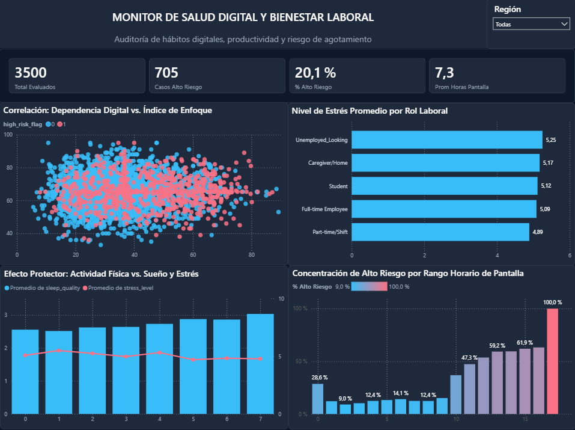

# 📊 Digital Health & Workplace Productivity Dashboard

Interactive Power BI dashboard analyzing digital habits, stress levels, and employee productivity across 3,500 evaluated cases.

---

## 🎯 Business Context & Problem Statement
Hyperconnectivity and continuous device exposure represent a growing risk for mental health and organizational performance. This project audits behavioral patterns across multiple roles and regions to identify
 Critical exposure thresholds that trigger high risk of burnout.
 The protective impact of physical activity against digital fatigue.
 Key differences between at-risk profiles and standard cohorts.

---

## 💡 Key Insights
 Critical Screen Exposure Threshold Risk probability increases sharply above 10 hours of daily device usage, jumping from baseline rates under 15% to over 60% (and reaching 100% in peak ranges).
 Sleep & Recovery Deficit High-risk individuals average nearly 1 hour less sleep per night (6.5h vs. 7.4h) and score 21% lower in reported sleep quality.
 The Exercise Buffer Engagement in regular physical activity (5+ daysweek) shows a measurable reduction in baseline stress scores and stabilizes sleep quality above 2.84.0.

---

## 🛠️ Tech Stack & DAX Highlights
 BI Tool Microsoft Power BI Desktop
 Data Prep Cleaned tabular dataset (3,500 rows, 24 features)
 Custom DAX Measures
   `Total Evaluados = COUNTROWS('Salud y Bienestar')`
   `Casos Alto Riesgo = CALCULATE(COUNTROWS('Salud y Bienestar'), 'Salud y Bienestar'[high_risk_flag] = 1)`
   `% Alto Riesgo = DIVIDE([Casos Alto Riesgo], [Total Evaluados], 0)`
   `Prom Horas Pantalla = AVERAGE('Salud y Bienestar'[device_hours_per_day])`

---

## 📂 Repository Contents
 `DSH_Salud_Digital_Bienestar_v1.0.pbix` Full interactive report model.
 `salud_digital_bienestar_raw.csv` Cleaned underlying dataset.
 `dashboard_preview.png` High-resolution visual capture of the reporting view.